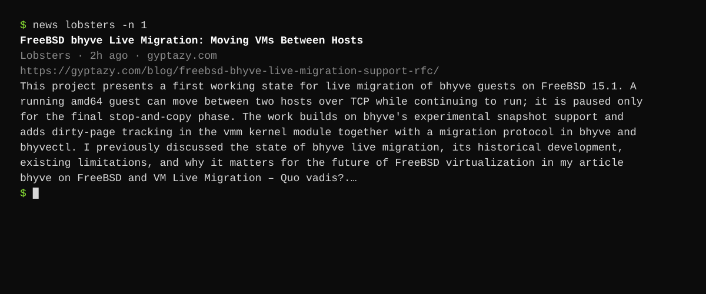

# news

A Rust CLI newspaper with full articles



## How it works

1. The selected source and topic choose an RSS feed, or GitHub's trending page
   when the source is `github`.
2. A single HTTP client fetches the feed with TLS verification, timeouts,
   redirect limits, and response size caps.
3. RSS is parsed locally. Source-specific metadata is added where it is useful:
   Hacker News points and comments, GitHub language and star count, and the
   linked domain for link aggregators.
4. By default it prints the full article text. Omarchy supplies the full article
   in its feed; BBC, Hacker News, and Lobsters article pages are fetched and
   extracted when needed. If extraction fails, it falls back to the short feed
   summary.
5. `--summary` forces the short version instead of the full article.
6. Output is plain text: a headline, source line, URL, and article text. It
   wraps to the terminal width.
7. One source is fetched per run. If it fails, the command fails; there is no
   aggregate mode.

## Usage

### Commands

| Command | Action |
| --- | --- |
| `news` | Print help. |
| `news <source>` | Latest stories from one source, with full article text. |
| `news <source> <topic>` | A topic or time range. |
| `news --summary <source>` | Print only the short summary. |
| `news sources` | List sources and descriptions. |
| `news --version` | Show the version. |

### Sources and topics

`news sources` (or `news --sources`) prints the source names and
a short description of each.

| Source       | Topics                                                                                                        |
| ------------ | ------------------------------------------------------------------------------------------------------------- |
| `bbc`        | `top`, `world`, `uk`, `business`, `politics`, `health`, `education`, `science`, `technology`, `entertainment`, `sport`, `football` |
| `github`     | `daily`, `weekly`, `monthly`                                                                                    |
| `hackernews` | `frontpage`, `newest`, `ask`, `show`, `jobs`, `best`                                                            |
| `lobsters`   | any tag, e.g. `rust`, `linux`, `security`, `programming`                                                      |
| `omarchy`    | no topics                                                                                                      |

The topic defaults to the source's front page or daily range.

### Examples

```bash
news bbc
news bbc sport
news github monthly
news hackernews ask
news lobsters rust

news --summary bbc
news sources
news bbc -n 5
news bbc --no-links
```

## Install

**Requirements:** Rust 1.88+, `git`, a C toolchain, and CMake for the TLS dependency.

```bash
cargo install --git https://github.com/batusaribay/news.git --locked
```

## Uninstall

```bash
cargo uninstall news
```

## Security

- TLS certificates are verified by `rustls`.
- Only public HTTP(S) pages are fetched. Localhost, private, loopback,
  link-local, and cloud metadata addresses are skipped, and redirects are
  checked against the same rules.
- Feed responses are capped at 4 MiB and article pages at 4 MiB; decompressed
  pages are capped at 8 MiB.
- Connect, request, and article timeouts are bounded, and redirects are limited.
- Terminal control characters are stripped from feed text, scraped text, hosts,
  and URLs before anything is printed.
- Feeds and article pages are fetched over the network, but no credentials are
  read, no configuration is written, and no telemetry is sent.
- Unsafe code is forbidden by the package lint configuration.

## License

This project is licensed under the [MIT License](LICENSE).
